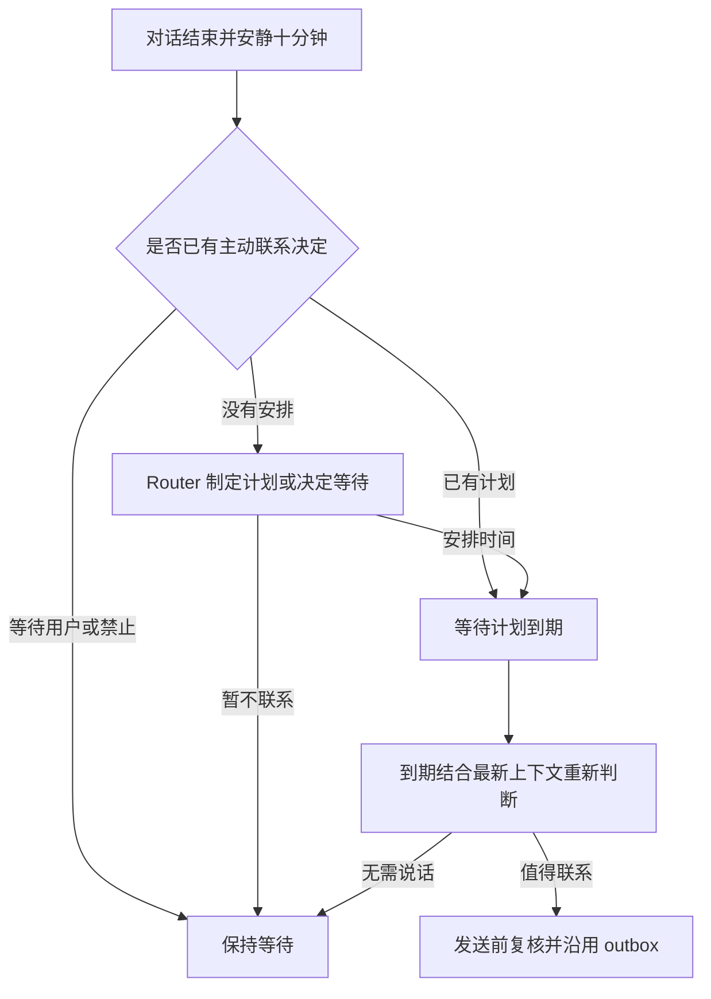

# 数字人主动联系 Implementation Plan

> **For Claude:** REQUIRED SUB-SKILL: Use superpowers:executing-plans to implement this plan task-by-task.

**Goal:** 用户与 Bot 对话结束并安静十分钟后，监视者检查 Bot 是否已有主动联系安排；缺少安排时由 Bot 自行决定何时、围绕什么话题再联系，到期重新判断是否值得开口。

**Architecture:** 复用现有宿主 tick、Router、聊天历史、记忆检索、SQLite 事务和 outbox。新增一份每 Bot 唯一的主动联系状态及有界运行记录，作为 Router 的内部唤醒来源；用户委托的 automation 保持独立。监视者只做程序判断，计划制定与到期判断均由原 Router 完成。

**Tech Stack:** TypeScript、Bun、现有 SQLite 连接、现有 Router 工具协议；手机设置沿用 React 和现有运行设置 RPC，不引入新的模型服务或常驻 AI Agent。

---

状态：设计与实施计划，尚未实现。日期：2026-11-28。默认参数是本方案的初始取值，后续可根据使用反馈调整。

## 1. 用户看到的行为

1. 用户最后一条消息已经被处理，Bot 的回复已经实际发送，双方安静十分钟。
2. 监视者查主动联系状态。Bot 已安排下次联系，或已决定等待用户、永久不主动联系时，监视者不再要求制定计划。
3. 没有安排时，监视者给 Router 一个内部请求：结合聊天上下文、有效记忆和相关任务，安排下一次主动联系，也可以决定暂不联系。
4. 到预定时间，重新读取最新上下文。话题仍值得跟进才生成消息；已经解决、刚聊过、不适合打扰时，取消、推迟或等待用户。
5. 生成消息后、真正调用发送接口前再核对状态。期间用户发来新消息，未开始发送的旧草稿失效。

Bot 在正常回复用户时也可以顺便保存主动联系计划。十分钟监视者负责补漏，不强制每次对话都安排联系，也不要求用户逐个设置提醒。

**第一版采用用户提出的逻辑：先检查 Bot 有没有自己的决定。没有决定才请它制定；已有有效决定就尊重它。**



## 2. 三类消息明确区分

| 类型 | 来源与例子 | 实现入口 | 关闭主动联系后的行为 |
| --- | --- | --- | --- |
| 用户委托的触发 | “明天下午三点提醒我开会”“每天检查版本” | 现有 `automation` | 原委托继续执行 |
| Bot 自主联系 | “日志发过去半小时了，问问排查情况” | 新增主动联系状态与内部触发 | 停止规划、到期判断和未发送消息 |
| 已有工作通知 | 任务交付、必要问题、执行失败 | 现有 Worker → Router → outbox | 按原任务规则处理 |

主动联系不能占用、删除或改写用户 automation。用户设置了提醒，不代表 Bot 已安排自己的主动联系；Router 可以根据该提醒选择等待，避免重复询问。

“以后别主动找我”作用于当前 Bot 的自主联系；“取消明天的提醒”作用于对应 automation。两者分别提交并返回实际回执。用户表达含糊时由正常聊天澄清。

## 3. 复用位置与必要增量

以下路径以 `ce-server-repo` 为根；手机路径以 `ce-platform-social` 为根。

| 现有组件 | 当前位置 | 本方案的使用方式 |
| --- | --- | --- |
| 宿主轮询 | `src/cli/bot-runtime/service.ts` 的 `tick` | 加一次到期记录查询，复用现有生命周期，无第二套常驻轮询引擎 |
| Router 排队与互斥 | 同文件的 `route`、`drainRouter` | 增加 `proactiveTrigger`，排在真实用户输入、Worker 结果及用户 automation 之后 |
| 对话与插话失效 | `routerInputChanged`、聊天账本 | 新消息使旧主动推理和未发送草稿失效；真实消息优先 |
| 有效记忆 | `memory-library.ts`、`memory-retrieval.ts` | 沿用当前身份、范围和时效筛选；通过已有工具补查 |
| 卷宗与任务 | `cases.ts`、`store.ts` | 提供实际进度、交付和问题是否已解决的证据 |
| 结构化决策 | `router.ts` 的 `router_decide` | 增加主动联系决定及主人控制字段，不额外启动一个“社交模型” |
| 发送与重试 | `replyCurrent`、`nextReply`、`drainReplies` | 增加主动来源校验；继续使用同一个 outbox ID |
| 非阻塞问题跟进 | `nudgeFollowups` | 保持原工作语义；主动联系不能重复已等待用户回答的问题 |

现有 `AutomationScheduler` 校验真实用户消息和执行委托，不能直接拿一个虚构用户消息注册自主联系。第一版的自主联系只有“一次性到期”和“等待”状态，在现有 tick 中检查即可，不复制 cron、指标采集或自动化任务执行器。

## 4. 每个 Bot 保存一个当前决定

在现有 SQLite 新增 `proactive_contacts`，`bot_id` 唯一；新增 `proactive_runs` 保存规划、到期判断、发送回执和失败原因。共享 `BotRuntimeStore` 的连接和事务。

```ts
type ContactRef =
  | { kind: 'message'; id: string }
  | { kind: 'task'; id: string }
  | { kind: 'case'; id: string }
  | { kind: 'memory'; id: string; version: number };

type ContactDecision =
  | { kind: 'unplanned' }
  | { kind: 'scheduled'; at: number; expiresAt: number;
      topic: string; approach: string; reason: string; refs: ContactRef[] }
  | { kind: 'review_at'; at: number; reason: string }
  | { kind: 'wait_user'; reason: string }
  | { kind: 'waiting_reply'; runId: string; sentAt: number }
  | { kind: 'disabled'; at: number;
      source: { kind: 'owner_message'; inboxId: string; quote: string }
        | { kind: 'owner_setting'; requestId: string }
        | { kind: 'migration' } };

interface ProactiveContact {
  botId: string; ownerId: string; groupId: string;
  revision: number; conversationRevision: number;
  decision: ContactDecision;
  timezone?: string;
  lastVisibleAt?: number; lastOwnerAt?: number;
  lastProactiveSentAt?: number;
  nextCheckAt?: number;
  retryAt?: number;
  lease?: { token: string; until: number };
  updatedAt: number;
}
```

- `revision` 保护计划和控制的并发修改；`conversationRevision` 在收到新主人消息、实际发送对外消息时递增，不依赖客户端时间。
- `lastVisibleAt` 记录最近主人消息的本机接收时间或 Bot 消息的实际发送时间。对方设备在线、模型完成生成均不能充当它。
- `nextCheckAt` 是宿主根据决定、安静期和退避计算的索引字段，不是第二份可被独立修改的计划。等待与禁止状态没有到期时间。
- `scheduled` 保存联系目的与切入角度，不预存一段到时必发的话。来源 ID 由宿主核实，不复制整段聊天进入新表。
- `proactive_runs` 包含 `id/botId/kind/state/contactRevision/conversationRevision/leaseToken/createdAt/finishedAt/outboxId/error`。运行状态覆盖排队、推理中、待发送、已发送、静默结束、失效、失败和投递待核对。
- 每个当前版本只允许一个活动运行；领取和提交使用事务、唯一约束与版本核对，不能只靠进程内锁。
- 租约默认两分钟，覆盖现有九十秒 Router 超时；轮询领取不能刷新旧租约。失败重试创建新运行与新令牌，原运行保留终态回执；同一决定只允许一个活动运行，不限制合法的退避重试。
- 模型调用次数、发送预留和实际发送按 Bot 与主人时区日期持久记账；重复回执不重复扣减。未尝试即取消可释放发送预留，投递结果未知时不释放。

### 状态规则

| 当前决定 | 监视者行为 | 退出条件 |
| --- | --- | --- |
| `unplanned` | 安静十分钟、符合条件后申请制定计划 | Bot 保存有效决定 |
| `scheduled` | 到期前等待；到期后申请重新判断 | 发送、推迟、放弃或新消息使其需重定 |
| `review_at` | 指定时间前等待，到时重新考虑 | 新决定或用户新消息 |
| `wait_user` | 持续等待，不周期催规划 | 主人再次发来真实消息或明确修改设置 |
| `waiting_reply` | 已主动发过，停止主动循环 | 主人再次发来真实消息 |
| `disabled` | 永久跳过规划和触发 | 主人明确恢复主动联系 |

`disabled` 就是用户所说“永不主动也是一种事件”的持久表达：它占据当前决定，不会到期、执行完成或因为普通聊天被清除。

用户新消息使 `scheduled/review_at/wait_user/waiting_reply` 回到 `unplanned`，保留旧记录供本轮 Router 参考。Router 可以在正常回复时更新原安排；否则本轮结束并重新安静十分钟后，由监视者补漏。`disabled` 只有明确恢复才能改变。

## 5. 监视者的具体判断

沿用现有约两秒 tick，主动联系到期查询最多每三十秒执行一次；没有到期记录就不调用模型。查询使用状态与 `nextCheckAt` 索引，不扫描每个 Bot 的完整聊天历史。

```ts
function eligibleForPlanning(s: WatchSnapshot, now: number): boolean {
  return s.decision.kind === 'unplanned'
    && s.enabledRuntime && s.hasOwnerConversation && s.hasTimezone
    && !s.hasPendingInput && !s.hasPendingReply && !s.routerBusy
    && !s.hasActiveWorker && !s.hasPendingWorkQuestion
    && !s.quiescing && !s.hasActiveLease
    && now >= s.lastVisibleAt + 10 * 60_000
    && now >= s.retryAt
    && s.insideContactHours && s.hasEvaluationBudget;
}
```

上面是纯函数的目标接口，`WatchSnapshot` 由有界 SQL 查询和运行时事实组装。已有待发任务结果、用户提醒、必要问题和真实输入先处理，不能为了主动交流占住 Router。

这个函数只处理 `unplanned` 补漏。`review_at` 到期领取 `plan`，`scheduled` 到期领取 `review`；二者复用同一组工作占用、时段、安静期、额度和租约门控，不要求状态先变成 `unplanned`。`retryAt` 缺省按零处理，尚无真实对话或 `lastVisibleAt` 缺失时直接跳过。

领取成功后，向同一 Router 队列加入 `proactiveTrigger: { kind: 'plan', runId }`。没有聊天输入时也能处理这个内部来源，不伪造 inbox、不增加“主人已说话”的轮数、不触发后台偏好提炼。

每个 Bot 的同一决定同时只能有一个活动领取。模型失败时保留原决定和失败原因，按 15 分钟、1 小时退避；同日连续三次失败后转 `wait_user`。每次 tick 的记录读取有界，模型调用也有明确预算。

## 6. Bot 怎样制定联系计划

正常聊天可选填写 `router_decide.proactive`；监视者的制定计划轮必须填写。建议使用以下判别联合：

```ts
type ProactivePlan =
  | { kind: 'schedule'; at: string; expiresAt: string;
      topic: string; approach: string; reason: string; refs: ContactRef[] }
  | { kind: 'review_at'; at: string; reason: string }
  | { kind: 'wait_user'; reason: string };
```

时间使用带时区 ISO，由宿主转换成毫秒。`schedule` 至少五分钟后、最多七天后；`expiresAt` 晚于 `at` 且不超过七天。`review_at` 至少一小时后、最多七天后。语义上不明确的“下次有空”不能直接作为时间。

输入包含当前宿主时间、主人时区、近期真实聊天、有效记忆摘要、关联任务/卷宗进展、上一次联系决定与联系记录。原文与详情按已有工具补查，沿用现有查询预算。

Router 需要回答：

1. 是否有值得接续的事情；依据哪条真实交流或工作记录？
2. 为什么在这个时间联系；从什么角度切入？
3. 什么情况出现后就不应再问？相关条件写在 `reason/approach`，到期时结合最新事实判断。
4. 没有值得说的话，选 `wait_user`；情况暂不明但值得稍后考虑，选 `review_at`。

角色与兴趣允许成为轻松交流的切入点；不能编造新的用户事实、外部观察或已经完成的后台工作。一次计划只安排一次联系，不自动变成每天早安或无限周期。

制定计划轮只能查询相关上下文、保存决定，`replies=[]`，不对用户发送“我准备半小时后找你”。宿主保存成功后返回真实记录版本；缺少决定、来源越界、时间非法或并发版本变化均不算成功。

## 7. 到期后怎样决定说不说

到期领取 `proactiveTrigger: { kind: 'review', runId }`，先过联系时段、消息优先级和频率限制，再读取最新聊天、记忆有效性、关联任务以及已有 automation/问题是否已覆盖这个话题。

Router 到期决定只有四种：

| 决定 | 保存结果 |
| --- | --- |
| `send` | 一个简短气泡，最多 100 个可见字符；保存到原 outbox |
| `schedule` | 修改联系时间或切入方式，保留来源与原话题关系 |
| `review_at` | 延后考虑，受评估次数和期限约束 |
| `wait_user` | 结束本次机会，保持等待，阻止监视者马上重建计划 |

已解决、已回答或用户表示不需要时，选 `wait_user`。临时被正常对话或工作占用，由宿主延后检查；不能把“未发送成功”当成用户没有回应。

自主轮只开放聊天、记忆、任务等必要读取，以及主动联系决定；宿主验证 `action=reply` 和上述结果。禁止在这个来源下调用 automation 创建、memory_write、项目工具或启动 Worker。需要新工作时，在消息中提出建议，由用户后续委托进入原流程。

### 发送事务与最后一道检查

1. 对照 `contactRevision/conversationRevision/leaseToken` 核实本轮仍有效。
2. 事务内保存决定、运行记录、额度预留及带 `proactiveRunId` 的 outbox；`source='proactive'` 由宿主绑定。
3. 在 `replyCurrent/nextReply` 复核：Bot/主人/私聊未变，未禁用，无新输入，时段和频率允许，来源未撤回，计划未过期。
4. 首次发起发送前再次核对对话版本。新消息使未开始发送的草稿取消，释放额度，先处理正常聊天。
5. 收到发送回执后，原子记录实际发送时间、消耗额度并进入 `waiting_reply`。本次发送产生的版本递增与状态更新在同一事务内处理，不能使自己的回执失效。

网络调用已经开始后，无法保证把消息追回。明确失败且上下文仍有效时，沿用同一 outbox ID 重试，不重生成消息；已经确认发送则不再投递。结果未知时保留额度预留并停止后续主动机会，不能宣称“从未发出”。

新消息、过期或禁止发生后，未尝试的消息直接取消；已经尝试但结果未知的自主消息转入运行记录的 `delivery_unknown`，停止自动重发，并从普通待发选择中隔离，避免挡住用户新请求和工作结果。首版只根据已有可核实的投递回执结束该状态，没有回执时保留待核对；不假定中继已有新增查询接口。旧 ID 与正文保留用于确认，不另造消息编号。正常用户回复不会清掉未知投递记录；要再次开启主动机会，须有明确的投递核对结果。

## 8. 初始参数与禁止主动联系

| 参数 | 初始值 |
| --- | --- |
| 监视者补漏等待 | 最后实际可见交流结束十分钟 |
| 可联系时段 | 主人明确设置的 IANA 时区 09:00–22:00 |
| 最近交流保护 | 到期联系时仍须安静至少十分钟 |
| 两次自主联系间隔 | 四小时；从实际发送时间计算 |
| 每日自主联系 | 每 Bot 最多两次，按主人时区记账 |
| 主动推理预算 | 每 Bot 每日最多四次，包含制定计划与到期判断；失败尝试也计入 |
| 无回应 | 一次主动发送后进入 `waiting_reply`，等主人再说话 |
| 同一话题 | 同一来源与事项没有新证据时，不重复发出相同跟进 |

预算耗尽时将下次检查放到下个允许日，不每次 tick 再次申请模型。安静期、时段或工作繁忙造成的程序延后不消耗模型预算；超出话题期限就进入 `wait_user`。首版按 Bot 限频，跨 Bot、跨宿主的主人总额度作为后续扩展，不宣称已有全局协调。

“以后不准主动发消息”通过正常 Router 决策的 `proactiveControl` 保存：`{action:'disable',sourceInboxId,quote}`。宿主验证当前真实主人消息、引文、版本，原子置 `disabled`、取消未发送自主消息和活动租约。设置页操作使用已认证主人与幂等 `requestId`。`enable` 也必须来自主人明确要求或设置操作，普通“你好”不会重新开启。

允许同时保存一条长期记忆解释偏好，但监视者直接读取 `disabled`，不依赖记忆是否被检索到、是否到期或被后台清理。修改记忆不能悄悄恢复主动联系。服务重启、换目录、模型切换、模式停用再启用均保留禁止状态。

旧 Bot 迁移为 `disabled(source=migration)`；主人开启一次后进入 `unplanned`，无需自行配置具体时间。运行设置页增加开关与时区，缺少可靠时区时不能启用。主人/私聊身份变化时使旧安排失效并恢复为未启用；切换目录取消旧项目话题，用户禁止决定继续保留。

## 9. 三个完整例子

**日志跟进。** 10:00 Bot 发出排查建议；它没有安排联系。10:10 监视者请求制定计划，Bot 保存“10:40 询问日志对应的问题是否解决”，切入点为当前卡点。10:40 最新记录仍未更新，Bot 决定发一条；发送成功后等待用户，不继续每半小时追问。

**提前解决。** 同一计划下，用户 10:20 说“已经解决了”。接收消息立即使旧主动推理和未发送草稿失效，原计划保留历史；正常 Router 根据已解决事实选择 `wait_user`。10:40 不发送旧追问。若正常回复未提交主动决定，10 分钟安静后只补一次规划，仍允许选择等待用户。

**永久禁止。** 用户说“以后别主动找我，明天会议提醒保留”。同一正常轮分别确认自主联系禁用和既有提醒状态。重启后监视者仍跳过这个 Bot，明天会议提醒照常触发。用户之后普通聊天不会解除禁用。

## 10. 实施任务

实施时使用 `@test-driven-development`，完成时使用 `@verification-before-completion`。下列任务按顺序执行；每个任务只提交自己的文件差异，不包含工作区已有的会话恢复、记忆或界面改动。

### Task 1: 持久状态与并发领取

**Files:** Create `src/cli/bot-runtime/proactive-store.ts`、`src/cli/bot-runtime/proactive.ts`、`test/bot-proactive-store.test.ts`；Modify `src/cli/bot-runtime/store.ts`、`src/cli/bot-runtime/types.ts`。

1. 写临时 SQLite 测试：重开数据库保留 `disabled/wait_user`；同版本并发领取只有一个成功；版本冲突整笔回滚；重复请求返回同一回执。
2. 运行 `bun test test/bot-proactive-store.test.ts`，确认因缺失主动状态接口失败。
3. 在同一连接创建状态、运行和回执记录及必要索引，实现第 4 节状态联合和 CAS/租约；旧数据显式迁为未启用，不假造主人消息。
4. 重跑本任务测试并运行 `bun run typecheck`，预期全部通过。
5. 提交本任务新增文件和精确差异，提交信息 `feat: persist bot proactive contact decisions`。

### Task 2: 十分钟监视者与有界退避

**Files:** Modify `src/cli/bot-runtime/proactive.ts`、`src/cli/bot-runtime/service.ts`；Create `test/bot-proactive-watch.test.ts`。

1. 使用可控时钟与假 Router 回调写测试：09:59 收到用户消息、10:00 实际回复，10:09:59 无唤醒，10:10 只唤醒一次；有未来计划、等待、禁止、待发消息或活动工作时均不唤醒。
2. 运行 `bun test test/bot-proactive-watch.test.ts`，确认时间门控与领取行为失败。
3. 实现第 5 节纯判断、到期 SQL 查询和 tick 接入；增加运行时可注入的主动时钟，使用持久退避与评估预算。
4. 测试反复 tick 和并发 poll 也不重复领取；预算用尽、时区缺失、凌晨与夏令时边界不唤醒；重跑任务 1 和任务 2 测试。
5. 提交 `feat: watch idle bot conversations for missing contact plans`。

### Task 3: Router 计划、来源限制和主人控制

**Files:** Modify `src/cli/bot-runtime/router.ts`、`src/cli/bot-runtime/service.ts`、`src/cli/bot-runtime/types.ts`；Create `test/bot-proactive-router.test.ts`。

1. 写协议测试：无用户输入仍可接收内部 plan；正常轮可顺便计划；plan 轮不发气泡；缺少合法决定不算完成；禁止/恢复只能绑定当前主人来源；自主轮不能创建 automation 或执行工作。
2. 运行 `bun test test/bot-proactive-router.test.ts`，确认现有路由尚不支持该来源。
3. 扩展 `drainRouter` 来源联合和 `router_decide` schema；使用当前有效记忆检索与有界历史；以宿主来源类型限制工具和动作，计划与决定原子保存。
4. 测试跨 Bot 来源、撤回来源、旧版本提交、旧推理覆盖新禁用、恢复后旧禁用重放均被拒绝；重跑主动测试及 `test/bot-router.test.ts`。
5. 提交 `feat: let router plan and control proactive contact`。

### Task 4: 到期重判、插话与发送回执

**Files:** Modify `src/cli/bot-runtime/service.ts`、`src/cli/bot-runtime/store.ts`、`src/cli/bot-runtime/proactive-store.ts`；Create `test/bot-proactive-delivery.test.ts`；Extend `test/bot-reply-dispatch.test.ts`。

1. 写可控协议测试：计划到期之前用户已解决则不发；推理期间新消息使结果失效；草稿入队后新消息取消首次发送；投递回执丢失不重复生成；禁用后未发送消息取消。
2. 运行 `bun test test/bot-proactive-delivery.test.ts`，确认主动发送门控失败。
3. 实现第 7 节 review 决定、一次性 outbox、配额预留和实际回执后的 `waiting_reply`；补齐已尝试发送且结果未知的核对分支，保持既有消息 ID。
4. 加重启用例：推理中租约过期可重判且不重复发；待发送时重启先查新上下文；未知发送保持待核对；停用模式与改目录不得复活旧消息。
5. 重跑上述测试及 `test/bot-automation-router.test.ts`、`test/bot-reply-dispatch.test.ts`、`test/bot-chat-rhythm.test.ts`，通过后提交 `feat: review and deliver proactive messages without stale followups`。

### Task 5: 手机开关、时区与状态可见

**Files (server):** Modify `src/cli/chat.ts`、`src/cli/main.ts`、`src/cli/bot-runtime/service.ts`、`src/cli/bot-runtime/types.ts`；Extend `test/bot-runtime-rpc.test.ts`。

**Files (phone):** Modify `src/core/contract/types.ts`、`src/core/contract/index.ts`、`src/social/botRuntime.ts`、`src/social/messages/BotRuntimeSheet.tsx`；Extend `src/social/messages/__tests__/BotRuntimeSheet.test.tsx`、`src/core/providers/__tests__/groupBotRuntime.test.ts`。`src/core/providers/groupImpl.ts` 已转发 `chat.botRuntimeUpdate`，只有契约适配确有需要时修改。

1. 写设置测试：只有主人可控制；旧 CE 没有能力标记时隐藏或提示升级；保存失败保留草稿；晚到响应不回滚已保存的禁用。
2. 分别运行服务端 RPC 测试和手机 `BotRuntimeSheet` 测试，确认新字段尚不支持。
3. 运行快照增加可选 `capabilities.proactiveContact=1`、`proactive` 状态；`chat.botRuntimeUpdate` 的 patch 增加带 `expectedContactRevision/requestId` 的主动设置块，复用原 RPC。开关与 IANA 时区同次保存，状态版本独立核对。
4. 设置页显示“已关闭 / 等待用户 / 下次考虑联系时间”，不展示内部来源路径；保存确认后使用服务器状态。旧客户端不提交新字段即可继续原行为。
5. 跑相关前后端测试与类型检查，通过后分别提交服务端和手机改动；不在此任务中部署或打包发布。

### Task 6: 端到端验收与用户说明

**Files:** Create `docs/bot-proactive-contact.md`、`test/bot-proactive-flow.test.ts`；必要时 Extend 既有 automation 和运行设置回归测试。

1. 写三条第 9 节流程测试，以及“没有话题选等待”“禁用跨重启保留”“用户提醒与自主计划互不串用”测试。
2. 跑测试观察预期断言，再完成遗漏的接线；使用临时 SQLite、假时钟、可控 RuntimeClient 与假发送端，不向真实联系人投递测试消息。
3. 执行下面的最终验证，预期无新增失败；已有失败单独记录，不能归为本方案通过。

```sh
# ce-server-repo
bun test test/bot-proactive-*.test.ts
bun test test/bot-automation-*.test.ts test/bot-reply-dispatch.test.ts test/bot-chat-rhythm.test.ts test/bot-runtime-rpc.test.ts
bun run typecheck
bun test
git diff --check

# ce-platform-social
npm run test -- src/social/messages/__tests__/BotRuntimeSheet.test.tsx src/core/providers/__tests__/groupBotRuntime.test.ts
npm run typecheck
npm run build
git diff --check
```

4. 更新用户说明，写清启用方式、十分钟补漏、到期可沉默、禁止与恢复、用户提醒独立、在线与网络投递边界。协议测试通过不等于真实模型能稳定选好话题，另用隔离本地会话验收日志跟进、话题已解决、永久禁止三例，保存真实结果而不向用户发测试消息。
5. 提交 `docs: describe and verify bot proactive contact`，列出实际执行的验证与限制。本方案的交付物是可审阅代码及验证记录，部署按后续明确任务处理。

## 11. 必须满足的验收条件

- 十分钟从最后实际对外交流计算；Bot 仍在回复、执行工作或等待必要回答时，监视者不制造新的主动话题。
- 没有计划才唤醒制定计划；已有计划、等待用户或永久禁止均能阻止无意义的重复唤醒。
- 无用户明确日程也可以由 Bot 自行安排一次联系；不伪造用户消息，不把自主计划写成用户委托。
- 到期必须重判；用户提前解决、生成时插话、排队时插话均不会使旧追问首次发出。
- `wait_user` 与发送后的 `waiting_reply` 都是有效决定，不会十分钟后被监视者当作“没有安排”。
- 永久禁止持久化且不自动恢复；用户已设的提醒、必要工作消息与自主联系按各自来源处理。
- 同一运行至多产生一个逻辑消息，失败重试不重新推理、不扩大授权，不把网络未知误算成用户未回应。
- 主人、Bot、私聊、来源与版本均由宿主核实；模型只能提出联系决定，不能自行取得工具或账号权限。
- 监视者的日常空检查不调用模型；模型调用、记录读取和历史保留有界，不依赖无限扫描。
- 时区、安静时段、额度、租约、永久禁止和已有未确认投递在重启后继续有效。

## 12. 当前实现参考

- [运行服务与发送链路](../../src/cli/bot-runtime/service.ts)
- [Router 指令、工具与决策](../../src/cli/bot-runtime/router.ts)
- [SQLite 账本](../../src/cli/bot-runtime/store.ts)
- [现有用户事件说明](../automations.md)
- [当前记忆机制说明](../bot-memory.md)
- [手机运行设置](../../../ce-platform-social/src/social/messages/BotRuntimeSheet.tsx)
- [手机运行契约](../../../ce-platform-social/src/core/contract/types.ts)

实施前以当时源码重新定位上述符号，保留工作区已存在的会话恢复和记忆功能改动；本次方案编写只新增本文档。
